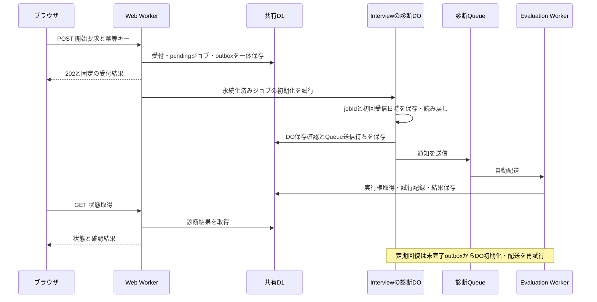

# 既存試作の移行と3 Workersのローカル接続確認の実装計画

> 実装担当者へ：`superpowers:executing-plans`を使い、タスクごとに実装・検証する。サブエージェント方式を利用者が選んだ場合は`superpowers:subagent-driven-development`を使う。チェック欄は実施後に更新する。

**目的：** 既存の一覧API試作を移行し、ローカルでWebから受け付けた診断ジョブがDO・Queue・評価Consumerを経て共有D1へ保存され、画面で結果を確認できる状態にする。

**構成：** Web・Interview・Evaluationの3 Workersと環境ごとに一つのD1を使う。診断専用Queue・DLQを通し、外部AIを固定スタブへ差し替える。受付と後続処理をD1へ先に保存し、停止後もEvaluationの定期回復で続行する。

**使用技術：** React、TanStack Start、Void、TypeSpec、Ajv、Cloudflare Workers・DO・Queues・D1、Void経由のDrizzle、Vitest。

**仕様：** [MVP仕様書](../../spec/mvp.md)、[用語集](../../../GLOSSARY.md)、[ADR一覧](../../README.md#設計判断の記録)。特にADR 0006〜0014を参照する。仕様が動作の原本であり、本計画は実装順序・配置・検証方法を具体化する。

## 対象と完了条件

2026年11月2日時点の作業ツリーを基準とする。対象読者は、仕様とADRを読んで実装を引き継ぐ開発者。2026年11月2日に実装へ着手した。チェック欄は実際の検証後に更新する。

完了時には、開発サーバーとビルド済みWorkerの双方で一覧の回帰検証と診断APIの実HTTP検証が通る。ブラウザから3シナリオを実行でき、成功1回・一時失敗後の成功2回・全4回失敗後のDLQ受信を区別できる。テスト実行で既存の開発データを変更せず、本番向けのローカルビルドに診断機能が含まれないことも確認する。

音声、実AI、材料の取り込み、正式な履歴API・削除API、Access、本番秘密値、クラウドへの配置は対象外。通常Queueの設定もローカルで検査するが、実AIによる正式評価の成功を意味しない。

## 共通の制約

- Node.jsは`.node-version`の26.12.1、pnpmは12.15.0。既存の依存保護設定とインストールスクリプト禁止を維持する。
- 現行のVoidは1.4.0、Cloudflare Viteプラグインはoverrideの1.64.0。Start 1.169.4、React 19.3.1、Vite 8.3.5、TypeSpec 1.17.0を初期基準とする。
- アプリのTypeScriptは7.0.2、`tools/api-codegen`だけ5.9.3とopenapi-typescript 7.13.0を維持する。試作の初回検証版と現行依存を混同しない。
- HTTPはTypeSpecからOpenAPI 3.1・型・AjvのES Modulesを事前生成する。QueueはTypeSpecから直接JSON Schema・型・Ajvを生成する。生成物はGit管理対象外。
- `APP_ENV`は`development / test / production`の必須値。未指定・誤記では停止し、`NODE_ENV`による代用やremote bindingを許可しない。
- developmentは`.local/development/`、testは`.local/tests/{実行ID}/{並列番号}/`に状態を分ける。Worker・D1・DO・Queue・生成設定・ビルド出力・lockを環境間で流用しない。
- 業務状態はD1、DOの状態はInterviewが管理する。D1・DO・Queueをまたぐ原子性や外部処理の厳密な一回実行を前提にしない。
- 日本語で画面・文書を記述し、[コードレビュー基準](../../../CODING_STANDARDS.md)に従う。型アサーションを外部入力の検証に代えない。
- 各タスクのテストケースは一つずつ追加する。追加直後にルートの`pnpm test`で期待した失敗を確認し、最小実装後に同じコマンドで成功を確認する。必要な整理後にも再実行する。
- 各タスク末尾で差分と検査結果を確認し、そのタスクのファイルだけをcommitする。push・PR・クラウド操作はこの計画に含めない。

## 現状と移行先

既存の`apps/typespec-spike`には、一覧2件を返すAPI、React画面、入力境界の共通ケース、HTTP検証がある。`typecheck`はルート型生成のためビルドを先に行い、`test`も契約を事前生成する。ルートの`pnpm test`と`pnpm typecheck`は再帰実行だが、workspace対象にはまだ`packages/*`がない。

次のファイル名とテーブル名は本計画で提案する実装名であり、作成済みではない。正式な面接の保存モデルを確定するものではない。

| 配置                      | 作成・移行する主要ファイルと責務                                                                                                                                |
| ------------------------- | --------------------------------------------------------------------------------------------------------------------------------------------------------------- |
| `apps/web`                | 試作の`src/router.tsx`、一覧画面・API・クライアント、`tests/`、`scripts/verify-http.ts`を移行。`src/diagnostics/`に診断画面・HTTPハンドラーを置く               |
| `apps/interview`          | `src/worker.ts`と`src/worker.local.ts`で入口を分離。`src/diagnostics/check-object.ts`で診断DOの保存・読み戻し・通知を行う                                       |
| `apps/evaluation`         | `src/worker.ts`と`src/worker.local.ts`、`src/domain/`の状態規則、`src/application/`の受信・回復、`src/server/repositories/`の条件付き保存                       |
| `packages/api-contracts`  | `http/main.tsp`、`http/diagnostics.tsp`、`messages/main.tsp`、`scripts/generate-validation.ts`、`scripts/generate-messages.ts`。生成先は`generated/`            |
| `packages/database`       | `db/schema.ts`、`db/schema/jobs.ts`、`db/schema/diagnostics.ts`、`db/migrations/`、`fixtures/`、`db/seed.ts`、`testing/`。業務処理を集約しない                  |
| `packages/runtime-config` | `src/environment.ts`、`src/resources.ts`、`src/artifacts.ts`。環境検証と接続先・生成先の対応                                                                    |
| `tools/local-integration` | `src/runtime.ts`、`src/run.ts`、`tests/`。独立した実ランタイムの起動・停止・接続検証・証拠保存                                                                  |
| 既存設定                  | ルート`package.json`、`pnpm-workspace.yaml`、`pnpm-lock.yaml`、`.gitignore`、`tools/api-codegen/package.json`、`.github/workflows/docs.yml`を移行に合わせて更新 |

各新規パッケージには`package.json`、`tsconfig.json`、必要な`vitest.config.ts`を置く。共通の型は契約または所有パッケージから公開し、アプリ同士をimportしない。現段階のジョブ制御はEvaluationが所有し、不要な共有ドメインパッケージを作らない。

## 接続と保存の具体化

受付直後の処理にはWebの実行継続機構を使えるが、成功応答をそれに依存させない。初期化の回復からInterviewへ到達するため、**Evaluationにも同じ環境のInterview DOバインディングを追加する案**とする。WebとEvaluationは同じ冪等なDO操作を呼び、初期化と最初のQueue送信はInterviewが担当する。以降の評価再試行・DLQ送信はEvaluationが担当する。新しい公開HTTP入口や4つ目のWorkerを作らない。

D1の保存単位は次を基準とする。

| テーブル案            | 主な列と制約                                                                                                                                                        |
| --------------------- | ------------------------------------------------------------------------------------------------------------------------------------------------------------------- |
| `jobs`                | `job_id`主キー、主体、用途`evaluation / diagnostics`、状態、試行回数0〜4、受付・更新・終了・次回日時、最後のエラー、所有者・世代・期限・試行終了期限                |
| `execution_slots`     | 主体を一意キーとした評価枠。ジョブと同じ所有者・世代・期限を持ち、一体で取得・更新・解放する                                                                        |
| `job_outbox`          | ID、ジョブ、用途、操作`initialize_do / notify / notify_dlq`、通知世代、予定日時、送信済み日時。一つの操作・世代を一意にし、送信後の停止による重複は受信側で吸収する |
| `diagnostic_requests` | 環境・主体・操作・冪等キーを複合一意にし、検証済みscenario、jobId、固定の受付結果を保持する                                                                         |
| `diagnostic_checks`   | jobIdを主キーにscenario、DO初回日時、3つの確認状態を保持する。診断固有の情報を共通ジョブへ混ぜない                                                                  |
| `job_attempts`        | jobIdと試行番号を一意にし、開始・終了・失敗コード・固定スタブの結果を記録する                                                                                       |
| `delivery_anomalies`  | 受信QueueとメッセージIDを複合一意にし、仕様の異常コード・用途・検証済みID・初回／最終日時・対応状況を保存。ジョブへの必須外部キーを持たせない                       |
| `deleted_jobs`        | jobIdと削除日時だけの最小記録。遅延通知テスト用に投入し、削除APIや保持期限の実装は含めない                                                                          |

公開日時はUTC・ミリ秒付きRFC 3339、DB内の期限比較は同じ単位のUTC整数ミリ秒に統一する。D1の単一操作または原子的batchで条件付き変更を行い、SQLの成功と条件不成立を区別する。Drizzleの一般的な対話型transactionがD1でも動くと仮定しない。

不在判定と実行権の判断はprimaryから開始する読み取りを使い、固定版Voidでの実現方法をタスク2で確認する。読み取り失敗を「存在しない」へ変換しない。共有パッケージはスキーマ・接続用の型を公開し、接続済みDBインスタンスを保持しない。

## 重点的に確認する失敗条件

| 条件                                       | 期待する結果                                             | 担当タスク |
| ------------------------------------------ | -------------------------------------------------------- | ---------- |
| 202応答消失・同時再送・受付直後の停止      | 同じジョブと受付結果を保持し、永続化した処理を再開する   | 4・5・9    |
| Queue送信後・ack前の停止                   | 再配送で試行や結果を二重に確定せず、DO初回日時を保つ     | 5・6・7・9 |
| 実行権の期限ちょうど・古い所有者の遅延保存 | 古い結果を拒否し、期限＋30秒より前に引き継がない         | 6          |
| D1照会失敗とジョブ不在・用途不一致         | 照会失敗はretry、異常は保存後ack。元ジョブを変更しない   | 7          |
| 環境切替・並列テスト・診断コードの本番混入 | 接続と生成物を分離し、診断コードの本番混入を検査で落とす | 2・8・9    |

## 実装タスク

順序は1→2→3→4→5→6→7→8→9→10。未検証の接続方式はタスク2で確認し、合意済みの責務を変更する必要があれば、その影響を示して計画とADRを見直してから進む。

### タスク1：一覧APIと契約生成を移行する

**変更先：** `apps/web/{package.json,vite.config.ts,void.config.ts,tsconfig.json,vitest.config.ts,src/,tests/,scripts/verify-http.ts}`、`packages/api-contracts/{package.json,tspconfig.yaml,http/main.tsp,scripts/generate-validation.ts}`、`tools/api-codegen/package.json`、ルートのworkspace・ignore設定。

**境界：** 既存の`listInterviews(request: Request): Response`と`getInterviews(baseUrl: string, fetcher?: typeof fetch)`の動作を維持する。HTTP生成物は`packages/api-contracts/generated/http/`からpackage exportsを通じて参照する。試作の`/api/interviews`は暫定契約のままとする。

- [x] 既存の共通ケースを移し、移行先へのimportで一覧2件・日時降順・limit境界・不正表記・未知キー・400本文の契約検証が成立するテストを一つずつ追加する。
- [x] 各追加後に`pnpm test`で移行先の未実装による失敗を確認する。
- [x] 実装・画面・生成処理を移し、`packages/*`をworkspace対象へ追加する。型生成専用パッケージの固定された入力・出力パスを変更する。暫定的に残す旧試作も新しい生成物を参照させ、旧パスの生成を二重管理しない。
- [x] 各ケースで`pnpm test`を通す。`pnpm typecheck`で生成→ルート型生成→型検査の順序を確認する。生成物のない状態からも通ることを確認する。
- [x] 新しいWebの`dev / build / preview / verify:http`スクリプトを定義し、開発とビルド済みWorkerで共通ケースを実行する。ブラウザで一覧2件と再取得を確認する。
- [x] 移行の証拠を保存してcommitする。旧試作の削除はタスク10まで保留する。

移行検証：2026年11月2日、生成物なしから`pnpm check`成功（360テスト）。開発4327・ビルド済み4328でHTTP契約28ケース、一覧順序、HTML、ブラウザの一覧2件・再取得を確認。既存32テストは期待値を保って移し、新しい一覧・クライアントの接続をRed/Greenで確認した。

### タスク2：環境設定と3 Workersの接続方式を確定する

**作成先：** `packages/runtime-config/src/{environment,resources,artifacts}.ts`と`tests/resources.test.ts`、各アプリの`void.config.ts`と入口、`tools/local-integration/src/{runtime,run}.ts`と`tests/topology.test.ts`。`packages/database`のCLI設定と最小スキーマもこの検証で用意する。

**境界：** `resolveRuntime(input: RuntimeInput): RuntimeConfig`。入力はAPP_ENV、テスト実行ID、並列番号、リポジトリルート。出力は環境、3 Worker名、D1識別子、DO参照先、用途別Queue・DLQ名、状態と生成物の絶対パス。testで識別子が欠ければ失敗する。`startRuntime(config: RuntimeConfig): Promise<LocalRuntime>`は`baseUrl`、`stop(): Promise<void>`、`runScheduled(): Promise<void>`を返す。定期実行の入口はテスト用ランタイム機構を使い、HTTP公開しない。

- [x] `resources.test.ts`へ未指定・誤記、同一環境の参照一致、異なる実行IDと並列番号の非共有を一つずつ追加し、各回`pnpm test`でRedを確認する。
- [x] 仕様の命名表に沿って設定を実装し、`pnpm test`でGreenを確認する。状態だけでなくVoidの生成設定・lock・Vite出力の解決先も検査する。
- [x] `topology.test.ts`にWebからInterview DOへの呼び出し、3 WorkersとDB CLIからの同一D1読み戻しを追加してRedを確認する。固定版の型定義・配布コードを調べ、`auxiliaryWorkers`を第一候補に入口とbindingを組み立てる。
- [x] 独立したtest環境で接続を実装し、同じテストをGreenにする。バックエンドの実際の入口、D1の取得方法、primary読み取り、原子的batch、CLIの状態保存先、ローカルscheduled起動方法を記録する。
- [x] 開発とテストを同時起動し、片方の固定値が他方から読めないことを確認する。異なる環境のlockが残る場合は起動時に拒否するか、環境固有作業先へ生成する。黙って再利用しない。
- [x] ルートへ`dev:local / build:local / preview:local / test:integration / db:generate / db:migrate / db:reset-seed`を追加する。DB操作はdatabaseの原本を参照する環境別作業先からVoid CLIで行い、remote操作を受け付けない。
- [x] 実ランタイム検証をcommitする。成立しなければこのタスクを未完了にし、単なるモックの成功で後続へ進めない。

実行検証：2026年11月2日、接続専用fixtureでDO・共有D1・scheduled・primary指定・batchロールバック・停止後の保持・build/previewを確認。開発と同一実行の並列2枠でデータと生成先を分離し、reset・seedの明示実行と使用中拒否も検証した。契約生成物なしから379テスト成功。実アプリの診断入口は後続タスクで置き換え、fixture成功を診断ジョブ全体の完成とは扱わない。

### タスク3：診断HTTP契約とQueue契約を生成する

**作成先：** `packages/api-contracts/http/diagnostics.tsp`、`messages/main.tsp`、`scripts/generate-messages.ts`、`tests/{diagnostics,messages}.test.ts`。既存のHTTP生成処理を拡張する。

**境界：** HTTPの開始・状態・エラー型とバリデーターを公開する。Queueの`JobNotification`は`schemaVersion: 1`と小文字UUID v4の`jobId`のみ。`validateJobNotification`を生成し、未検証データと検証済み通知を区別する。型の原本を手書きで増やさない。

- [x] 固定の正常通知が通り、版2・文字列の版・余分な項目・不正UUIDが拒否されるケースを一つずつ追加し、`pnpm test`でRedを確認する。
- [x] TypeSpec JSON Schema emitterと型生成手段の固定版互換性を確認し、生成→Ajv ES Modules→Worker importを実装して各ケースをGreenにする。入力変換・既定値補完・余分な項目削除を無効にする。
- [x] HTTPの3シナリオ、開始202、GET 200、400・404・409・415・500・503を操作ごとに定義する。`no-store`、`Location`、UUID、ミリ秒付き日時、必須null項目、型付きdetailsを仕様どおりに定義する。
- [x] 不正JSON・空本文・キー不足・未知scenario・未知項目・不正jobIdの契約ケースを一つずつRed/Greenで追加する。実ハンドラーの検査はタスク4で同じケースを再利用する。
- [x] 生成物なしからの生成・型検査・`pnpm test`を確認する。新規依存は完全な版番号で固定し、保護設定を維持したlock更新をcommitする。

実装検証：Queue通知はJSON Schema・型・Ajvの生成と実Workerへのimportを確認。診断HTTPは開始・状態・エラーの型と専用バリデーターを生成し、UUID・日時・必須null・型付きdetails・未知項目拒否を検証した。既存の制約で初回から成功するケースは、人工的に制約を弱めず補足検証とした。不正JSON・空本文は要求fixtureと期待エラーを用意し、実際のHTTP解析と応答はタスク4で確認する。

### タスク4：共有スキーマと冪等な開始受付を実装する

**作成先：** `packages/database/db/schema/{jobs,diagnostics}.ts`、`db/migrations/`、`testing/database.ts`、`tests/migrations.test.ts`、`apps/web/src/diagnostics/{accept,get,errors}.ts`、`src/server/repositories/diagnostic-jobs.ts`、`tests/diagnostics.test.ts`。

**境界：** `acceptCheck(request: Request, deps: CheckDependencies): Promise<Response>`と`getCheck(request: Request, jobId: string, deps: CheckDependencies): Promise<Response>`。依存には環境、サーバー側の固定開発主体、DB、時計、ID生成を渡す。受付結果はTypeSpec生成型を返し、DB行を直接公開しない。

- [x] 同じキーの同時要求が同じjobId・acceptedAt・Locationを返し、ジョブと初期化outboxが各1件になるテストを実D1で追加し、`pnpm test`でRedを確認する。
- [x] 前掲のスキーマを実装し、一意制約と原子的保存で受付を作る。競合時は確定済み受付を読み直し、検証済みscenarioを比較する。結果不明は503とし、新規キーの生成を促さない。
- [x] `pnpm test`でGreenを確認し、同じ入力の再送・異なる入力の409・検証失敗後の修正再送・終端後の再送を一つずつRed/Greenで追加する。
- [x] タスク3の入力ケースを実ハンドラーへ適用する。JSON Content-Type、no-store、応答契約、404の主体範囲、要求ごとのrequestId、秘密値・内部例外の非公開を一つずつ確認する。
- [x] 空DBへの全履歴適用、既存行を保持する追加適用、再適用の重複防止、失敗した適用の状態を実D1で検証する。失敗検証は使い捨てDB内で行い、不正なmigrationを正式履歴に残さない。
- [x] 起動・通常migrationでseedやresetが走らないことを確認する。固定データ投入は明示的な`db:reset-seed`だけとし、変更と検査結果をcommitする。

実装検証：2026年11月2日、実ローカルD1で同時・逐次・競合・終端後の受付、状態取得の主体と用途の制限、入力契約、D1障害503、requestIdのログ対応を確認。予期しない内部例外500はハンドラー単体テストで確認した。公式Void CLIで旧履歴からの追加適用・再適用・途中失敗の巻き戻し・修正後再実行を検証し、通常migrationでseedが走らないことも確認。失敗用履歴は独立テスト環境だけに作成し、正式履歴には含めない。テーブル再作成のmigrationには全列コピーを確認した上で個別の許可を付け、外部キー検査を移行中だけ遅延させる。DO初期化とQueue配送は次タスク以降で実装する。

### タスク5：診断DOの保存からQueue送信まで接続する

**作成先：** `apps/interview/src/diagnostics/check-object.ts`、`src/server/repositories/check-outbox.ts`、`tests/check-object.test.ts`。Webの受付後処理とEvaluationの初期化回復用bindingを接続する。

**境界：** DOの`initializeCheck(jobId: string): Promise<CheckInitialized>`は、`jobId`と保存済み`firstReceivedAt`を返す。DO名は環境と`diagnostics`の用途を含めて決める。DOはD1の診断ジョブと初期化待ちを照合して処理し、呼び出し元からscenarioや用途を上書きさせない。

- [x] 同じjobIdで二回初期化して初回日時が変わらないテストを追加し、`pnpm test`でRedを確認する。
- [x] DOストレージへの保存・読み戻しを実装し、成功後だけ`doPersistence=passed`と通知outboxをD1へ一体保存する。診断Queueへ検証済み2項目通知を送り、送信成功後に送信済みを記録してGreenにする。
- [x] 受付後、DO保存後、D1進捗保存前、Queue送信前後で停止するケースを一つずつ追加する。再呼び出しで同じDO・ジョブを保ち、通知の重複を許容して消失を防ぐ。
- [x] Webの202返却後に初期化を試みる。失敗しても既存受付を取り消さず、outboxを残す。診断の初期化回復をEvaluationの定期実行へ接続する。
- [x] 実ランタイムでDO再起動後の読み戻しと自動Queue配送を確認し、commitする。Consumerの業務完了は次タスクで検証する。

### タスク6：評価の実行権と固定スタブの3シナリオを実装する

**作成先：** `apps/evaluation/src/domain/{job-state,lease,retry-policy}.ts`、`src/application/consume-job.ts`、`src/server/repositories/job-execution.ts`、`src/diagnostics/evaluator.ts`、`tests/{execution,lease}.test.ts`。

**境界：** `consumeJob(notification: JobNotification, context: DeliveryContext, deps: EvaluationDependencies): Promise<DeliveryDecision>`。`DeliveryDecision`はackまたは30秒後のretry。`DeliveryContext`はQueue名・メッセージID・期待用途・通常/DLQ区分。固定スタブの`evaluateDiagnostic(scenario, attemptNumber)`は成功結果か`SIMULATED_AI_FAILURE`を返し、共通制御処理はscenarioを参照しない。

- [x] `success`が試行1回で結果とcompletedを保存するケースを追加し、`pnpm test`でRedを確認する。
- [x] 主体枠とジョブを原子的に取得し、試行開始を記録してスタブを呼ぶ。所有者・世代・期限・状態・未削除を保存時にも照合し、結果・終端状態・枠解放を整合させてGreenにする。
- [x] 同時取得で一つだけが実行すること、別ジョブの枠待ちでは試行回数を増やさず次回通知を保存することを、一つずつ実D1でRed/Greenにする。
- [x] 時計を差し替え、AI待機120秒、試行上限180秒、30秒ごとの更新、期限ちょうどの保存拒否、期限＋30秒での引き継ぎ、世代が古い保存の拒否を一つずつ検証する。
- [x] `retry_then_success`は試行2回でcompleted、`exhaust_retries`は試行4回でfailedとなるケースを追加する。再試行間隔30・120・300秒、次回時刻より前の実行拒否、最後のエラーを成功後も保持することを検証する。
- [x] 失敗確定時はDLQ送信待ちを保存する。`consumerCompletion`と`dlqReceipt`のpending・passed・not_expectedをシナリオごとに仕様と照合する。
- [x] Queueの配送回数が増えても業務試行回数に加算されないこと、完了後の再配送がスタブを呼ばないことを確認し、commitする。

### タスク7：定期回復・DLQ・配送異常の隔離を実装する

**作成先：** `apps/evaluation/src/application/{recover-jobs,consume-dlq,classify-delivery}.ts`、`src/server/repositories/{outbox,delivery-anomalies}.ts`、`tests/{recovery,dlq,delivery-anomalies}.test.ts`。

**境界：** `recoverJobs(deps: RecoveryDependencies): Promise<RecoverySummary>`を60秒周期のscheduledから呼ぶ。初期化待ちはタスク5のDO操作、通常通知とDLQ通知は用途別Queueへ送る。DLQの入口もタスク6の`DeliveryContext / DeliveryDecision`を使う。

- [ ] 受付直後の停止から初期化・送信を再開するテストを追加し、`pnpm test`でRedを確認する。
- [ ] 未送信、再試行時刻到達、期限切れ実行権、未送信DLQ通知を回復する。条件付き更新で二重回復を防ぎ、Greenにする。
- [ ] D1照会失敗はretry、不在は`JOB_NOT_FOUND`、用途不一致は`JOB_PURPOSE_MISMATCH`として保存後ackになるケースを一つずつ追加する。用途検証を実行権取得より先に行う。
- [ ] 不正形式・未対応版では本文のIDでジョブを照会・変更しない。隔離保存失敗はretry、保存後ack前の停止は同じQueue・メッセージIDの記録へ集約する。別メッセージIDは別記録にする。
- [ ] 削除済み識別情報がある通知は遅延として記録し、ジョブを復元しない。用途不一致のジョブの状態・試行回数・実行権・正常な回復通知を変更せず、自動転送しないことを検証する。
- [ ] DLQでcompleted・cancelled・failed・有効なrunning・次回通知ありをそれぞれ検証する。実行者も次回通知もない未完了ジョブは、まず回復への引き継ぎを永続化する案とし、DLQ到着だけで失敗へ変えない。
- [ ] failed確定とDLQ受信の間は`dlqReceipt=pending`、実受信保存後だけpassedにする。DLQ保存失敗はretryとし、他のDLQへ連鎖転送しない。
- [ ] 実ランタイムでQueue配送の30秒・最大3回再試行とDLQ到着を検証する。診断スタブの4回の業務試行とは別の、使い捨て環境の配送失敗試験にする。
- [ ] 定期実行の重複起動と送信済み記録前の停止を検証し、commitする。

### タスク8：診断画面と本番成果物の分離を実装する

**作成先：** `apps/web/src/diagnostics/{page,client}.tsx`、開発用route生成設定、`apps/web/tests/diagnostics-client.test.ts`、`tools/local-integration/tests/production-artifacts.test.ts`。各Workerの開発・本番入口を更新する。

**境界：** 開発・テスト専用の`/diagnostics`画面から仕様の開始・状態APIを呼ぶ。生成型とバリデーターを使用し、ジョブごとのキーを通信結果不明時にも再利用する。新しい実行の操作でのみ新規キーを作る。

- [ ] 202応答が失われた後の再送で同じキーを使うクライアントテストを追加し、`pnpm test`でRedを確認する。
- [ ] 3シナリオの選択、開始、状態再取得、3つの確認結果を表示してGreenにする。HTTP障害とジョブのfailedを分け、failedだけで「DLQ確認済み」と表示しない。
- [ ] 入力エラーはcodeで分岐し、GET応答が契約外なら表示に使わないテストを一つずつ追加する。再送中の画面操作でも別ジョブを作らない。
- [ ] 開発用routeファイルは本番のファイルルート走査対象外に置く。生成route treeとクライアント配信物まで環境ごとに分離する。3 Workersの本番入口は診断モジュールをimportしない。
- [ ] 本番モードのローカルビルドについて、モジュールグラフ・生成route tree・配信アセット・Worker設定を照合し、診断コード、失敗注入、診断Queue bindingがないことを検査する。単なる文字列検索だけを証拠にしない。
- [ ] 診断importを一時的に本番入口へ加えた場合に検査が失敗することを確認して戻す。ビルド済みローカルHTTPでも診断パスが404となり副作用がないことを確認する。
- [ ] ブラウザで開始・状態再取得・3シナリオの結果表示を確認し、commitする。

### タスク9：統合検証を再現可能な操作入口にまとめる

**変更先：** `tools/local-integration/src/{runtime,run}.ts`、`tests/{end-to-end,isolation,restart,formal-routing}.test.ts`、ルート`package.json`、`.github/workflows/docs.yml`。

**境界：** ルートの`test:integration`は実行IDと並列番号を発行し、test環境のみを起動・準備・破棄する。証拠は`.local/tests/{実行ID}/{並列番号}/results.json`に環境、固定版、ケース、期待値、実測値、終了コードを保存する。秘密値や入力本文は保存しない。

- [ ] 実HTTPから開始した`success`のDO保存・Queue自動配送・Consumer完了・GET結果を一つのテストにし、未接続箇所によるRedを確認する。Consumerを直接呼んだ結果で代用しない。
- [ ] 実ランタイムを接続してGreenにし、`retry_then_success`、`exhaust_retries`を順に追加する。業務再試行は30・120・300秒を短縮せず、時計差し替えの単体検証と実時間の証拠を分ける。
- [ ] 受付応答消失、受付直後停止、DO保存後停止、Queue送信直後停止、結果保存後ack前停止、ランタイム再起動を一つずつ検証する。失敗注入は独立test環境の専用入口でのみ行う。
- [ ] 開発DBに固定の保持確認行を置き、並列test環境二つの実行後も値・件数が変わらないことを確認する。テスト同士のD1・DO・Queue・出力も共有されないことを確認する。
- [ ] 通常Queueについて、WebとInterviewの送信先が同じ環境のEvaluationへ届き、通常DLQも受信できることを別に検査する。正式用途の架空ジョブとテスト専用評価器を使い、診断スタブを本番入口へ組み込まない。
- [ ] 開発・ビルド済みWorkerの両方でHTTP契約ケースを実行する。ローカルscheduledはタスク2で確認したランタイム入口を60秒周期で駆動し、手動でアプリの回復関数を呼ぶ試験と区別する。
- [ ] CIにローカル統合検証を追加する。現行5分のジョブとは分け、当初20分のタイムアウトを設定して実測後に調整する。Actionsの新規依存は原則増やさず、Workflow名`Documentation checks`を維持する。
- [ ] CIの通常テストと実時間の長い統合検証を分ける。ルート`pnpm test`には単体・契約・実D1境界テストを含め、実時間の全経路試験は`test:integration`で明示実行する。起動失敗・timeoutも失敗終了し、起動したプロセスを確実に停止する。
- [ ] `pnpm check`と新しい統合検証入口を通してcommitする。

### タスク10：旧試作を整理して検証記録を引き継ぐ

**変更先：** `docs/README.md`、`docs/spec/mvp.md`の実装状況、`tools/docs/README.md`、`apps/web/README.md`、`docs/runbooks/local-development.md`、`docs/research/local-worker-integration.md`。`apps/typespec-spike`を削除する。

- [ ] タスク1〜9の証拠と回帰ケースの移管先を確認する。生成、型検査、テスト、開発起動、ビルド済みWorker、ブラウザのいずれかが未確認なら旧試作を削除しない。
- [ ] 試作READMEの互換性制約と検証履歴を移し、旧試作を削除する。`rg`で旧パス参照を調べ、現行の手順・CI・生成ツール・仕様のリンクを更新する。過去の計画内の歴史的記述は現行手順と区別する。
- [ ] ランブックへ起動・停止、DB適用、明示リセット、各シナリオ、失敗時の確認先を記載する。コマンドは実装済みのpackage scriptsと一致させる。
- [ ] 検証記録に各ケースの実施日、固定版、開発／ビルド済み、実時間／時計差し替え、観測結果、未検証事項を記録する。本番Access・実AI・クラウドの成功へ言い換えない。
- [ ] 仕様の受入条件と本計画のタスクを再照合し、`pnpm check`と統合検証を実行する。文書リンク切れ、旧パス依存、開発データの変化がないことを確認してcommitする。

## 実装中に結果で確定する点

- タスク2でバックエンド入口、primary読み取りと原子的更新、DB CLIの保存先、環境別生成物、ローカルscheduledの起動方法を確定する。固定版で成立しないときは、バージョンや責務を黙って変更しない。
- タスク3でQueue Schemaから型を生成する手段と依存版を固定する。Queueの型を別原本として手書きする代案は採用しない。
- Evaluationから診断DOへのbinding、DLQの孤立した未完了ジョブをまず回復へ引き継ぐ処理、前掲のテーブル構成は本計画の具体化案。実装で責務や保存保証が変わる場合は仕様との整合性を再確認する。
- 長期障害後のDLQ枯渇・保持期限・通知運用、正式な削除とバックアップ復元、実AIのモデルと費用、クラウド配置は[後続機能の設計・検証事項](../../spec/mvp.md#後続機能の設計検証事項)へ残す。この計画の成功条件へ追加しない。
