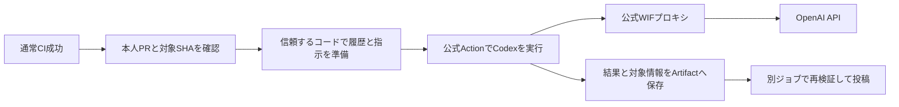

# ユーザーの既存実装と公式WIFプロキシを使うAIレビュー

2026年10月28日改訂。TypeScript変更後の敵対的検証を反映した設計案。利用者は「ユーザーの既存実装を基に公式WIFプロキシとCodex Actionを使う方式」「実行ごとの$1厳密上限の撤廃」「公式unprivileged-userによる資格情報隔離と、読み取り専用環境内でのPRコード実行の許容」を選択した。本書の詳細は設計案であり、実装・依存追加・Workflow変更・有料検証の開始は承認されていない。

2026年10月28日追記: 利用者が実装開始を承認した。[実装計画](../plans/2026-10-28-codex-review-migration.md)に従い、まず実資格情報を使わない隔離検証から着手する。以下の「未着手」「承認されていない」は設計時点の記録であり、実接続・有料検証・本番切替の完了を意味しない。

## 目的と判断

現在のレビューは資料選択、分割、横断確認、候補統合、出力不足回復を自前で制御し、実PRで完走できない状態が続いた。ユーザーの既存レビュー処理と公式Codexの探索機能を使い、独自に保守する範囲を減らす。WIF、本人PR限定、対象コミットの固定、投稿権限の分離、指摘履歴の保持は維持する。

| 比較した方式                                        | 利点と負担                                                            | 選択         |
| --------------------------------------------------- | --------------------------------------------------------------------- | ------------ |
| 公式WIFプロキシを先に起動し、公式Codex Actionへ接続 | 起動接続は必要だが、Codex実行・権限制御・出力取得をActionに任せられる | 利用者が選択 |
| 公式WIFプロキシとCLIを直接起動                      | Actionとの接続は不要だが、実行・権限・終了処理の管理が増える          | 採用しない   |
| 現行SDKと分割制御を継続                             | 現行の細かな台帳を保持できるが、独自制御を減らす目的に合わない        | 置き換える   |

公式プロキシのWIF機能は公開版ソースで確認したが、Actionとの接続と別UIDでの隔離は未検証である。利用者が隔離した読み取り専用環境内のPRコード実行を許容したため、厳密な実行禁止を理由とする保留条件は解除する。これは隔離の検証済み判定や実装着手の承認ではない。実現可能性と根拠は[WIF導入調査](../../research/codex-action-wif-feasibility.md)、ユーザーの既存実装の機能は[既存実装調査](../../research/existing-ai-review-investigation.md)に記録している。

## 全体構成

生成ジョブだけがOIDC権限を持ち、投稿ジョブだけがPRへの書き込み権限を持つ。プロキシとCodexは同じ生成ジョブ内で権限を分けて動かす。新しいクラウドサービス・永続DB・独自プロキシは追加しない。

### 対象の確認と準備

現在の`workflow_run`、通常CI成功後、本人作成・同一リポジトリ・main向け・非Draftという条件を維持する。起点CIが検査したPRのbase/headと実行・試行を固定し、現在のPRと食い違えば生成しない。同じPRの更新では旧実行をキャンセルする。

認証と投稿に使う実行コードは信頼するmainのコミットへ固定する。プロンプト準備・履歴処理・結果検証・投稿は、既存の`tools/ai-review`内のTypeScriptで実装する。ユーザーの既存実装からは処理の責務・入出力契約・検証条件を引き継ぎ、Goコードの逐語移植やGo CLIのラッパーは作らない。参照元への実行時依存や自動追従は設けず、参照コミットと採用した動作・変更理由を残す。

PRのコードは別の調査用ディレクトリへ配置する。資格情報を扱う準備処理では、準備用CLI・プロンプト・Schema・Codex設定を信頼する版から使い、PRのコード・依存インストール・テストを実行しない。Codexが調査中にPRコードを実行する場合は、後述の隔離した読み取り専用環境内に限る。baseとheadの原文は読めるようにするが、全文を自前の巨大なJSONへ詰め直さない。

### WIF接続とCodex実行

現行のWorkflowパス・main・イベント条件を維持し、既存のOIDCクレーム照合を再利用する。OpenAI側のマッピングを広げて接続問題を回避しない。既存Provider・サービスアカウントの利用を前提とし、実設定との一致は接続検証で確認する。

公式プロキシを`--github-oidc`で起動する。GitHubのOIDC要求用資格情報を標準入力のパイプから渡し、交換・更新は公式実装へ任せる。現行の独自WIF交換ループと残存240秒の判定は引き継がず、プロキシの期限管理へ置き換える。APIキー用入力へWIFトークンを渡さない。

独自に用意する接続処理は、プロキシ起動・起動確認、接続設定・server-infoの作成と権限設定、終了処理に限定する。ActionのAPIキー入力は空にし、事前作成した信頼するCodex homeから既存プロキシへ接続する。正常・失敗の両方でプロキシを終了し、秘密を含まない状態だけを保存する。

資格情報の隔離には、利用者が選択した公式Actionの`unprivileged-user`と読み取り専用プロファイルを使う。実runnerでの成立は未検証である。従来案の`drop-sudo`と呼び出し側の環境変数の空設定だけでは、runnerによるOIDC変数の再注入とActionの環境継承を防げない。[資格情報の追加調査](../../research/codex-wif-credential-isolation.md)に根拠を記録した。

専用の非特権ユーザーにsudo・特権グループ・サービスソケットへのアクセスを与えず、公式Actionがそのユーザーへ切り替える境界で環境を最小化する。sudoの`env_reset`を有効にし、OIDC要求用トークン・要求URL・GitHub APIトークンが`env_keep`・`env_check`やPAM等から追加されないことを確認する。`env_delete`の追加だけを除去の保証にしない。独自の実行ラッパーは作らない。

接続設定は専用ユーザーの実HOMEの`.codex`へ事前配置し、任意の`CODEX_HOME`の環境継承に依存しない。設定・server-infoは準備側が保護し、Codexが必要とする実行時ファイルとは権限を分ける。runner側の認証ファイルを共有しない。プロキシは資格情報を保持する保護されたプロセスとして特権側に置く。環境だけでなく親runner・プロキシのメモリとファイルへの到達性も検証する。Bearerを引数、設定、ログ、Artifact、GitHubの出力・環境ファイルへ保存しない。

### PRコードを実行できる範囲

利用者の選択により、Codexが調査のためにPR由来のスクリプトやテストを実行することを許容する。実行は専用の非特権ユーザーと公式の読み取り専用サンドボックスの内側に限り、Codexから起動するすべての子プロセスにも同じ境界を適用する。PRのコードを信頼する準備・認証・投稿処理へ昇格させる許可ではない。

- 調査対象のソース、信頼する設定、server-infoを変更できない。PRの処理のために追加の書き込み先・サンドボックス外実行・sudo権限を与えない。
- OIDC・OpenAI・GitHubの資格情報を環境・ファイル・親プロセスから取得できない。認証ファイルや特権サービスソケットを共有しない。
- 調査コマンドへ任意の外部ネットワークを許可しない。モデル通信は公式WIFプロキシを経由する。プロキシへの通信と一般コマンドのネットワーク制限を混同しない。
- PR側のCodex設定・MCP・フックを信頼する起動設定として取り込まず、PRから権限・接続先・実行方式を変更できないようにする。
- Codex自体に必要な実行時ファイルと結果の書き出しは、準備側で確保した領域と公式の実行機構に分離する。これをPRコードへ任意の書き込み権限を与える根拠にしない。

依存取得・キャッシュ書き込み・外部サービス接続などを必要とするテストは、読み取り専用環境内で動かないことを受け入れる。レビューのために制限を緩めず、実行できなかった確認として記録する。通常CIのテストをここで全て再実行する構成にはしない。

厳密なコマンド許可リストやPRコード非実行の保証は求めない。公式のユーザー切替・サンドボックスとOS設定を使い、独自サンドボックス・読取MCP・コマンド代理・資格情報除去ラッパーを追加しない。背景は[実行制限の調査](../../research/codex-pr-execution-restrictions.md)を参照する。資格情報隔離や読み取り専用境界が検証できなければ、その段階で停止し、権限を緩めて通過させない。

### レビューと出力

ユーザーの既存実装のプロンプトと構造化出力を基に、変更内容と過去指摘を一つのCodex実行で確認する。Codexが差分から必要な原文を探索する。自前の資料分割・確認範囲台帳・横断確認ジョブ・候補整理ループ・出力枠拡大は設けない。

規約の案内は本リポジトリのコードレビュー基準、MVP仕様書、領域別ADRに置き換える。仕様・文書変更も対象にする。規約の選択は信頼する設定で行い、変更された文書の内容はレビュー対象データとして区別する。

新規指摘は現行どおり最大3件。過去指摘は最大30件を別枠で全件確認する。ユーザーの既存実装の20件上限・修正済み除外をそのまま採用しない。30件を超える場合や履歴取得失敗時に黙って省略しない。

履歴処理の独自上限は次のように整理する。設計者の修正案であり、モデルの任意規模の完走を保証するものではない。

| 対象                                        | 新方式での扱い                                                         |
| ------------------------------------------- | ---------------------------------------------------------------------- |
| 過去指摘数                                  | 最大30件を維持。超過時は明示して停止                                   |
| 1スレッドの返信数20件                       | 廃止。1指摘に21返信あっても、それだけでは拒否しない                    |
| コメント本文16KiB・履歴JSON128KiB           | 廃止。ユーザーの既存実装独自の固定容量判定を移植しない                 |
| 現行TypeScriptの10ページ・1,000コメント制限 | 廃止。通常コメント・レビューコメントの両方で固定ページ数を引き継がない |
| GitHub APIの取得制約・取得失敗、ジョブ期限  | 制約が残る。全件取得できなければ省略せず未完了                         |
| Codexの入力・出力・実行上限                 | 公式の制御に従う。終了できなければ未完了。独自分割や再生成は追加しない |

ページ取得はAPIの取得終了を確認するまで続ける。総コメント1,000件・1,001件でも件数だけでは停止せず、過去指摘30件の上限と総コメント数を混同しない。API失敗や処理期限内に全件取得できない場合は未完了とし、途中までの履歴で生成・投稿を続けない。ページ数の固定値を引き上げるだけの対応はしない。

履歴本文は取得済みの原文ファイルとして置き、プロンプトには全対象IDと読取先を渡す。全返信をプロンプトへ埋め込むユーザーの既存実装の方式は変更する。Codexに必要箇所を読ませ、各指摘の判定を全件要求する。古い返信の切り捨て・独自要約・固定容量の引き上げで回避しない。取得と検証の処理時間も生成ジョブの期限に含める。

修正判定は修正済み・未修正・確認不能を区別し、元の指摘IDと根拠を返す。全履歴IDの結果がそろわない、Schema不正、生成失敗、対象不一致の場合は投稿しない。一方、資料を調べても個別指摘の判断がつかない場合は確認不能として扱い、そのことだけで他の有効な結果を破棄しない。

完了はCodexの正常終了、出力検証、必要な履歴判定、保存・投稿の成功で定義する。全資料を読んだこと、不具合がないこと、分割台帳の網羅を保証する意味にはしない。指摘ゼロでも履歴に未修正・確認不能があれば修正完了と表示しない。

### 保存と投稿

生成結果をArtifactへ固定し、投稿は信頼するコードを使う別ジョブで行う。保存する情報は、形式の版、リポジトリ・PR・base/head、起点CIと生成実行のID・試行、実行コードのSHA、結果・結果ハッシュ、生成時の履歴一覧と改訂値、予定する投稿操作、処理状態に絞る。履歴一覧は信頼する準備処理から保存し、モデル出力だけから再構成しない。公式出力から取得できる利用量は記録するが、欠損をゼロ料金と扱わない。会話全文やプロキシのリクエストダンプは保存しない。

投稿側はArtifactの生成元と対象・形式を検証し、現在のheadだけでなくbaseも照合する。新規指摘の位置を差分で検査し、返信前にはスレッドの現在状態を確認する。不正なArtifact、対象変更、取得時点で観測できる人間や別実行による履歴の差異は停止理由を残し、古い結果を投稿しない。同じArtifactに基づく自分の書き込みは、以下の再開契約で区別する。

ユーザーの既存実装の投稿契約をTypeScriptで実現し、投稿処理を一つに統合する。現行のTypeScriptからGitHub通信・コメント識別・履歴読取の必要な処理を再利用し、旧投稿フローを並行稼働させない。新方式では、状態が変わった場合だけの返信、修正済み指摘の再発確認、現在のコメントマーカー・旧集約コメントの読取互換を追加する。旧指摘の識別と状態読取は既存ロジックを仕様・テストの根拠として移植し、モデルに任せない。投稿本文は現行の修正確認文言を維持し、旧集約コメントには元コメントへのリンク付き通常コメントで返す。

履歴取得と改訂値の計算は生成・投稿で同じ処理を使う。取得した原文・コメントID・投稿者・返信関係・スレッドのResolve状態を共通のスナップショットへまとめ、モデルに渡す指摘一覧と改訂検知の両方に用いる。比較に必要な情報はArtifactに固定し、取得順の違いで改訂扱いにしない。元指摘だけを返す現行の履歴読取結果は、返信やResolve変更を検知できないため、改訂値の代用にしない。必要な状態を取得できなければ推測せず停止する。

同じ生成Artifactの再投稿は、次の契約で未完了分だけ再開する。再開保証の前提は、元のArtifactが利用でき、投稿済み操作のマーカー付きコメントが本文・対象を含めて保持され、必要な履歴を全件読み取れることである。対象SHA・履歴の照合が成立しない場合は再開せず停止する。独立したDBや可変の投稿台帳、削除を追跡する監視基盤は追加せず、固定ArtifactとGitHub上の投稿を使う。

1. 生成時に、全対象指摘のID・元コメント・返信・Resolve状態から作る改訂値を保存する。新規指摘・各返信・完了通知について、対象と期待する本文のハッシュを含む投稿操作を固定する。
2. 操作IDは生成元の実行・試行と固定結果、操作種別・対象から決める。投稿ジョブを再試行しても変えず、新しい生成とは区別する。本文の専用マーカーは信頼する投稿器で付与し、モデルの自由文から採用しない。
3. 再開時は履歴不一致を判定する前に、同じ操作IDの投稿を探す。投稿者・PR・返信先・対象コミット・本文の一致を確認できたものだけを投稿済みと認める。マーカーだけが一致する場合は停止する。
4. そのArtifact自身の確認済み書き込みだけを比較対象から除いて、生成時の履歴改訂値と照合する。元コメントの編集、人間の追記、別実行の返信、Resolve変更が残れば停止する。自分が作った新規指摘スレッドも同じ操作照合で識別する。
5. 未投稿の操作だけを実施する。書き込み直前に対象と外部の履歴変更を再確認する。APIで書き込みが成功し応答だけ失われても、投稿済みコメントが保持され読み取れる場合は、次の再開で操作IDと本文を照合して重複を避ける。

複数のGitHub書き込みは原子的ではないため、途中失敗で既に投稿した内容を消さない。元のArtifactがない場合は再開できないと扱い、再生成を投稿再試行と偽らない。同じ対象への新しい生成結果が投稿済み内容と食い違う場合は追加投稿せず停止する。投稿の同時実行はPR単位で直列化し、生成実行のキャンセルだけを重複防止の根拠にしない。Resolve・再オープンは操作しない。

#### 再開保証の限界と手動削除時の運用

履歴の改訂検知は取得時点で観測できる差異を対象とする。取得の間に追加・削除されて消えた変更や、一度変更されて元の状態へ戻った履歴を漏れなく検知する保証ではない。特に「投稿成功→応答喪失→返信削除」の後は、固定Artifactと現在の履歴だけでは未投稿と区別できず、同じ返信を再作成し得る。削除を検知できない場合まで自動停止できるとは扱わない。

途中投稿のコメントを手動削除する場合は、先に当該実行の投稿処理を停止し、終了を確認する。削除後は同じArtifactで投稿ジョブを再試行しない。既に削除した場合も同じ扱いとし、PRに残るコメントと実行記録を利用者が確認する。続行には新しい履歴を取得した再レビューを用い、旧Artifactの再開として扱わない。再レビューではモデル呼び出しと追加費用が発生し得るほか、削除済み指摘を再び検出する可能性がある。手動削除を今後の指摘禁止指定とは扱わない。

この運用は利用者による操作の制約であり、削除後の再試行を技術的に防止する仕組みではない。誤って同じArtifactを再試行すると、削除したコメントが再作成され得ることを投稿再試行の案内に明記する。削除された投稿の完全な追跡や、成功応答後だけ保存する独自台帳によってこの限界を解消したとは主張しない。

書き込み直前の検査と投稿も原子的ではない。PR単位の直列化は自動投稿同士を制御するもので、人間の操作をロックしない。検査後から投稿までの競合窓は残り、継続する操作の再確認で差異を観測した場合は以降の投稿を停止する。既に行った投稿は削除しない。

PRチェック表示と失敗通知は現行の仕組みを再利用する。新しい生成結果から既存の状態形式へ変換する境界を一か所に置き、分割作業固有の診断は生成しない。レビュー成功、生成失敗、投稿失敗、キャンセル、対象更新を区別し、通知の成功をレビュー成功へ置き換えない。

## 独自実装を残す範囲

| 部分                                       | 採用元・変更範囲                                                                       |
| ------------------------------------------ | -------------------------------------------------------------------------------------- |
| 認証交換・更新、モデル通信                 | 公式WIFプロキシ。fork・機能追加をしない                                                |
| 探索・モデル呼び出し、構造化出力           | 公式Codex CLIとAction。独自の再分割・再生成ループを作らない                            |
| 準備・履歴・検証・投稿                     | 既存のTypeScript基盤。参照元の処理契約と現行の規約・履歴互換・返信条件・対象照合を実現 |
| PRの認可と実行対象固定、チェック・失敗通知 | 現行実装を再利用。新しい結果との接続だけを変更                                         |
| WIFプロキシとActionの接続、Artifact        | 小さな起動・保存処理。既存の保存・検証方式から必要な部分だけを利用                     |
| 課金予約・精算・分割作業台帳               | 新方式では廃止。旧台帳を満たすためのダミー値を作らない                                 |

実行環境は既存のNode.js・pnpm・TypeScriptを使い、ルートの版指定と検査へ統合する。Goのツールチェーン・依存管理・CI検査は追加しない。型検査とVitestを維持し、外部入力は型アサーションだけに頼らず実行時に検証する。公式Action・CLI・WIFプロキシはそのまま利用し、TypeScriptで認証交換やモデル実行を再実装しない。

現行のTypeScript処理は必要な境界だけを再利用する。投稿器やArtifact検証に結び付いている分割・予算管理は新しい結果契約から切り離し、旧エンジン全体を残す理由にしない。参照元のテストは期待する振る舞いの根拠とし、履歴互換、対象更新時の停止、投稿応答喪失後の再試行、長い履歴の非切捨てをTypeScript側で検証する。調査済みのGoコードの挙動は、新しいTypeScript実装の検証済み証拠とは扱わない。

### 履歴・投稿処理の再利用境界

| 責務                 | 再利用するもの                                                                  | 変更・追加する範囲                                                                              |
| -------------------- | ------------------------------------------------------------------------------- | ----------------------------------------------------------------------------------------------- |
| GitHub通信と履歴取得 | 現行の認証付き通信とコメント取得の基本処理                                      | 固定ページ数を廃止し、返信・Resolve状態を含む取得を一か所へ集約                                 |
| 旧指摘の互換読取     | 現行のコメント識別、旧マーカー・旧集約コメントの解析、返信状態の読取とテスト    | 共通スナップショットから元指摘を取り出す。独立した旧履歴エンジンは残さない                      |
| 履歴の改訂検知       | 参照元の改訂照合の考え方と反例テスト                                            | 返信・Resolve状態を含む改訂値の作成・照合をTypeScriptで共用。現行の元指摘一覧の比較は置き換える |
| 投稿内容と認可       | 現行の対象PR・SHA・差分行の検証、本文の安全な表示、状態変更時だけの返信とテスト | 固定した投稿操作へ接続。旧投稿フローを包むラッパーは作らない                                    |
| 投稿再開             | 既存のArtifact受渡しとGitHub上のマーカー照合の基本方式                          | 生成元に固定した操作IDと期待本文を照合し、自分の書き込みを除外して未投稿分だけ実行              |
| Artifact検証         | 対象・生成元・ハッシュを検証する考え方と利用可能な純粋処理                      | 新形式の入口で検証し、分割計画・完了タスク・課金台帳を要求する旧検証器は使わない                |

追加する独自処理は、共通スナップショットによる改訂照合と、固定した投稿操作の照合・再開に限定する。初回投稿と再投稿は同じ処理を使い、別の再開エンジンを作らない。操作の完了はGitHub上の投稿から確認し、可変DB・独自キュー・汎用ワークフロー基盤は追加しない。操作IDの照合後に行う履歴比較では、確認済みの自分の書き込みだけを除外し、同じbotによる別実行の投稿まで除外しない。

これらは既存コードの無変更再利用ではなく、合意済みの履歴・再開要件を満たすための限定的な変更である。参照元のGo実装は契約とテストの根拠として使い、現行TypeScriptとの二重実装にしない。

独自実装最小化は、合意済みの履歴や認可要件を黙って削る意味ではない。移植時に差分が大きくなる場合は、その要件と保守負担を明示して設計を再確認し、独自エンジンを追加して吸収しない。

## 費用・期限・版の管理

利用者の選択により、生成実行ごとの$1厳密上限と、それを支える事前計数・料金予約・精算を廃止する。時間制限は費用上限ではなく、1回の実行が$1を超える可能性を受け入れる。利用量と請求側の実績を初期検証で照合する。

以下は設計者の初期値とする。Codex実行15分、生成ジョブ20分、投稿ジョブ10分。既存PRチェックの監視枠に収める。独自の自動再生成は行わず、手動の生成再実行は追加課金があり得ることを区別する。プロキシ・CLI内部の再試行は固定版の挙動を検証し、外側に再試行を重ねない。

モデルは現行のGPT-6 Lunaを維持し、effortはユーザーの既存実装に合わせてmediumを初期値とする。WIF経由のモデル利用可否は未検証であり、失敗時に別モデルへ自動変更しない。Actionは調査済みv1.13のコミット、CLIとプロキシは0.164.0を最初の互換性検証候補として固定する。公開版の対応関係と固定SHAは[調査記録](../../research/codex-action-wif-feasibility.md#根拠の版と未検証事項)を参照する。更新時には接続・権限境界の検証を行う。

## 移行と設計文書の位置付け

[ADR 0005](../../adr/0005-partitioned-ai-review.md)の静的分割・ツールなし実行・$1予算管理を、新方式では置き換える。変わった前提は、公式の探索機能とWIF更新機能を利用できること、利用者が厳密な費用上限より独自実装の削減を優先し、資格情報を隔離した読み取り専用環境内でのPRコード実行を許容したことである。現行ADRのPRコード非実行方針は、この環境内に限って見直す。準備・認証・投稿側では引き続きPRコードを実行しない。

本書は新方式の設計案であり、現在動いている実装は変更していない。[現行仕様](../../spec/ai-review.md)と[分割設計](../../spec/ai-review-partitioning.md)は移行前の仕様として残す。本書の承認後、実装着手が別途指示された段階で正式仕様・ADR・運用手順を更新し、旧方式と新方式の適用範囲を明示する。

切替時は同じPRで両方式を自動実行しない。新方式の生成結果には新しい形式の版を付け、旧Artifactを誤って投稿しない。切替前の実行は完了を待つか停止し、旧方式の保存結果は監査用として保持する。既存コメントは削除せず新方式で引き継ぐ。切替後の障害では自動で旧モデル処理へ戻さず、新規生成を停止できるようにする。

## 実装前後に確認する条件

実装が指示された場合も、次の順番で検証する。前段が成立しないまま大規模レビュー処理を作り込まない。

1. 実資格情報を渡す前に、公式の別UID実行と読み取り専用設定を無害なfixtureで検証する。PR側のスクリプトが境界内で実行できる一方、ソース・信頼設定の変更、昇格、任意の外部通信、模擬資格情報・親プロセス・保護ファイルの読取りは拒否される。シェルやインタープリターを経由する子プロセスでも同じ制限が働き、PR側の起動設定で回避できないことを確認する。
2. 固定した公式バイナリでWIFプロキシが起動し、既存の限定マッピングで交換できる。ActionがAPIキーなしで接続し、指定モデルとSchemaで小さな結果を返す。実runnerでも資格情報の値を出力せず非継承を確認し、長時間のトークン更新、更新失敗、終了時の後始末を検証する。
3. 小さな既知バグと正常変更で結果を確認し、保存と実PR投稿まで完走する。古いhead/base、不正Artifact、履歴の取得失敗では投稿しない。
4. 旧コメントの引継ぎ、修正確認、再発、確認不能、同状態の返信抑止、Resolve非操作を確認する。「A返信成功→B失敗→同じArtifactでBから再開」「書き込み成功・応答喪失」「再開前の人間の追記」「並行する投稿試行」を検証する。自分の返信では再開でき、人間の追記では停止し、投稿だけの再試行でモデル呼び出しが増えない。1指摘21返信、16KiB超の本文、128KiB超の履歴でも旧固定上限だけでは拒否されず、必要な原文が保存・参照できる。通常コメント・レビューコメントそれぞれで総数1,000件・1,001件かつ過去指摘30件以内を確認する。末尾まで取得できれば件数だけで拒否せず、途中のAPI失敗・期限超過では部分履歴を採用しない。人間の返信追加・元コメント編集・Resolve変更は改訂として停止し、取得順だけの変化では停止しない。
5. 応答喪失後もコメントが保持される場合は再投稿しないことを確認する。応答喪失後にその返信を削除した場合は未投稿と区別できず再作成され得る限界を確認し、手動削除後に同じArtifactを再試行しない案内と整合させる。元からスナップショットにあるコメントの削除など、観測できる差異での停止と区別する。
6. 以前失敗した規模・内容のPRで、終了状態、品質、利用量、保存・投稿を実測する。小規模テストの成功だけを大規模PRの完走保証にしない。

別UID方式での資格情報非継承、親プロセス・ファイル・ネットワークを含む隔離、既存マッピングとの実際の一致、事前起動プロキシとActionの接続、モデル・期限更新、大規模PRの完走は未検証である。PRコードの厳密な実行禁止は新方式の受け入れ条件に含めない。実装担当は具体的な配置・引数・内部関数を決められるが、認証境界や費用・履歴要件を変えて検証を通すことはしない。

## 敵対的検証への対応

[検証記録](../../research/existing-review-wif-adversarial-validation.md)のP1には、生成時の履歴固定と操作IDによる自分の書き込みの識別、応答喪失を含む再開契約を追加した。P2には、30指摘上限だけを維持し、移植元の20返信・16KiB・128KiBの独自上限を廃止する方針を追加した。どちらも設計上の対応であり、実装による解消は未検証である。

資格情報については、利用者が選択した公式の別UID方式とOS設定へ改めた。PRコード非実行を理由とする保留条件は、隔離した読み取り専用環境内の実行を許容する利用者の判断によって解除した。公式機能で厳密な非実行を実現できたという意味ではない。隔離の検証条件、独自実装の最小化、実装未着手は維持する。

[TypeScript変更後の検証](../../research/typescript-review-adversarial-validation.md)のP2に対し、現行通信処理の10ページ上限も廃止対象へ追加した。履歴の改訂検知と投稿再開は、共通スナップショットと一つの投稿処理へ集約し、旧履歴解析などの再利用範囲を明示した。設計への反映のみで、実装による解消は未検証である。

[投稿再開の再検証](../../research/review-resume-adversarial-validation.md)のP2に対し、投稿済みコメントが保持され読取可能なことを再開保証の前提に追加した。手動削除後は同じArtifactを再試行しない運用と、誤って再試行した場合の再作成の可能性を明記した。独自DB・監視基盤は追加せず、観測できない変更と検査後の競合は保証範囲から区別する。実装・実運用での検証は未実施である。
